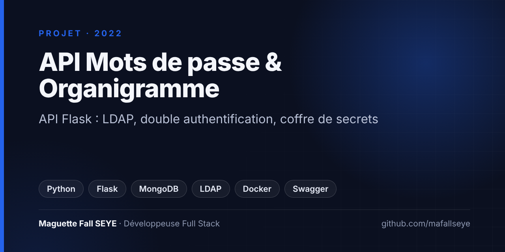

<p align="center"></p>

# API Mots de passe & Organigramme

API Flask de gestion des mots de passe et de l'organigramme d'une entreprise : LDAP, double authentification, coffre de secrets.

## Fonctionnalités

- Authentification LDAP et double authentification par e-mail
- Coffres de secrets partagés par équipe
- Organigramme : rôles, membres et demandes d'accès
- Images Docker (API + Nginx) et documentation Swagger

## Technologies

Python · Flask · MongoDB · LDAP · Docker · Swagger

## Lancer le projet

Prérequis : Python 3.9 ou plus et une base MongoDB.

```bash
git clone https://github.com/mafallseye/password-organigramme.git
cd password-organigramme
python -m venv .venv
source .venv/bin/activate   # Windows : .venv\Scripts\activate
pip install -r requirements.txt
cp .env.example .env         # puis renseigner les valeurs et les charger dans le terminal
python app.py
```

## Configuration

Aucun identifiant n'est écrit dans le code : les accès (base de données, e-mail, clés de signature) sont lus dans des variables d'environnement. La liste est dans [`.env.example`](.env.example).

> Projet réalisé en 2022 pendant mon stage chez AXETAG SAS. Il est conservé ici comme trace de mon parcours.

## Auteure

**Maguette Fall SEYE** — Développeuse Full Stack, Dakar (Sénégal) · [github.com/mafallseye](https://github.com/mafallseye)
